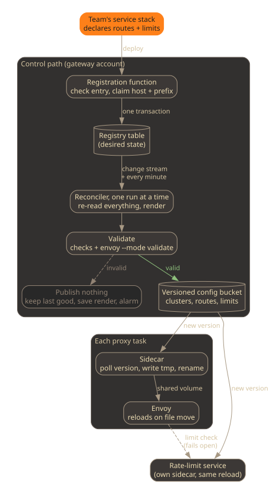

At work we run one Envoy gateway in front of many teams' private APIs.
Requests reach it through a CDN and a load balancer, and Envoy matches the
Host header to one virtual host per team before forwarding to that team's
API. It started the way shared gateways usually start: one config file in
the gateway repository, and a pull request to it every time a team needed a
route. That works for three routes. It stops working once every team waits
on the gateway team to ship a route, and every reviewer of that file has to
know every team's backend.

This post describes what we replaced it with. In short:

> Teams declare their routes and rate limits as data in a registry. One
> reconciler, running one instance at a time, rebuilds the whole proxy config
> from that registry, validates it with the same Envoy release the gateway
> runs, and publishes it to a versioned store that a sidecar loads into the
> running proxy. A bad registration can never replace the last good config.

## The constraints

- Teams own their routes. A team adds, changes, and removes its routes from
  its own deployment, without a change in the gateway repository.
- One team cannot break another. A typo in one team's route must not take
  down the others, and two teams must not be able to claim the same
  hostname or path.
- Route changes need no restart. Envoy picks up new routes while serving
  traffic.
- Rate limits belong to the route. The team that owns a route knows what it
  can handle, so the team declares the limit next to the route.
- There is always a way to stop all traffic that does not depend on the
  parts that might be broken.
- No control plane to run, until we have a reason to need one.

## The pattern



### Registration is a data write

A team's infrastructure code declares its routes. Ours uses a CDK construct,
but the shape matters more than the tool:

```ts
exposeOnGateway(this, "Invoices", {
  host: "invoices",
  routes: [
    {
      path: "/invoices",
      methods: ["GET"],
      limits: [{ per: "client-ip", requests: 100, every: "minute" }],
    },
    {
      path: "/invoices",
      methods: ["POST"],
      limits: [
        { per: "route", requests: 500, every: "minute" },
        { burst: 20 },
      ],
    },
  ],
});
```

On deploy, this calls a registration function in the gateway account. The
function checks the entry: every hostname label is a valid DNS label, every
limit has a known unit, a limit per header names the header. Then it writes
the entry to a table, together with one guard row for the hostname and one
for the hostname and path prefix, in a single conditional transaction. If
another service already holds either guard, the transaction fails and so
does the team's deploy, with an error that names the conflict. On stack
delete, the same function removes the entry and its guard rows in one
transaction.

The team's deploy fails fast on its own mistakes. Nothing in the registry is
proxy config yet.

### One reconciler rebuilds everything

The table's change stream triggers a reconciler, and a schedule triggers it
once a minute as a backstop. It runs with a concurrency of one, so two
renders never race.

The stream event is only a wake-up call. The reconciler never applies the
change it was told about. It rereads the full registry and renders the
complete config from scratch: Envoy clusters, routes, and the rate-limit
service's rules. Missed events, duplicate events, and backstop runs all end
in the same output. In sketch form:

```ts
async function reconcile(): Promise<void> {
  const entries = await registry.readAll();
  const config = render(sortByService(entries)); // byte-stable output
  if (config.hash === published.hash) return;

  if (entries.length > 0 && config.routeCount === 0) {
    throw new Error("registry has entries but rendered no routes");
  }

  const result = await validateWithEnvoy(config); // same Envoy release as the fleet
  if (!result.ok) {
    await keepForDiagnosis(config, result.stderr);
    await alarm(result.summary);
    return; // the last good config stays live
  }

  await store.publish(config);
  published = config;
}
```

Sort the entries before rendering. Without a stable order, the same
registry renders different bytes, the hash check never matches, and every
run publishes.

### Validate before anything is published

Validation runs in three layers, cheapest first:

1. Checks that know the gateway's rules: no two virtual hosts with the same
   domain, at most one catch-all `*` virtual host (Envoy rejects the whole
   route table otherwise), and the rate-limit rules use the domain the proxy
   asks for.
2. An empty-render guard. A registry with entries that renders zero routes
   is a bug, never an intent.
3. `envoy --mode validate` against the rendered files, wrapped in a minimal
   bootstrap that loads them the way the gateway does. It runs in a function
   built from the same Envoy release as the gateway image. We pin the
   version in one place, and a test fails when the gateway image falls
   behind it.

The third layer is the one we would keep if we could keep only one. Our own
checks only know the mistakes we have thought of. Envoy's parser knows every
field it rejects.

When validation fails, the reconciler publishes nothing. The running proxies
keep the last good config, the failed render goes to a bucket for whoever
debugs it, and an alarm fires. The team whose registration caused it sees
its route not appear. Traffic for everyone else is untouched.

### Deliver files, let Envoy watch them

Envoy can read its clusters and routes from files and reload them when they
change, without a control plane. The bootstrap, baked into the image, points
the dynamic resources at a watched directory:

```yaml
dynamic_resources:
  cds_config:
    resource_api_version: V3
    path_config_source:
      path: /config/clusters.yaml
      watched_directory:
        path: /config
```

The route table works the same way through the `rds` block of the HTTP
connection manager. The listener and the HTTP filters stay static in the
bootstrap. Changing those needs a new task. We accept that, because they
change rarely and a fresh start validates them.

The reconciler is the only writer of the published files, which live as
objects in a versioned bucket. A sidecar in each proxy task polls them,
downloads a new version to a temporary file, and renames it over the watched
path:

```sh
seen=""
while true; do
  version=$(aws s3api head-object --bucket "$BUCKET" --key routes.yaml \
    --query VersionId --output text)
  if [ -n "$version" ] && [ "$version" != "$seen" ]; then
    aws s3api get-object --bucket "$BUCKET" --key routes.yaml \
      --version-id "$version" /config/routes.yaml.tmp > /dev/null &&
      sync -f /config/routes.yaml.tmp &&
      mv /config/routes.yaml.tmp /config/routes.yaml &&
      seen=$version
  fi
  sleep 15
done
```

The rename is the important line. Envoy reloads when a file is moved into
the watched directory, so it never reads a half-written file. Downloading
the exact version the sidecar just saw means a write that lands between the
two calls gets picked up on the next round instead of being skipped. Envoy
waits to start until the sidecar reports healthy, which means both files
exist on disk.

The rate-limit service gets its rules the same way: its own sidecar, its own
watched file, a reload on change.

Two guards protect the published files. The reconciler compares the live
object's version with the version it last published, and raises a metric
when someone else wrote it. And the deployment that creates the bucket seeds
the files with a conditional write that only succeeds if the object does not
exist yet, so a redeploy of the gateway cannot overwrite what the reconciler
published.

### Rate limits fail open

Each route's limits render into two places from the same code: the route's
rate-limit actions in Envoy, and the rate-limit service's rule tree, keyed by
team, route, and then client IP or header value. Rendering both from one
module keeps them from drifting apart. A local burst limit, enforced in each
Envoy task without a network call, sits next to the global one.

The global limit fails open. When the rate-limit service does not answer
within a short timeout, Envoy forwards the request. An explicit over-limit
answer still returns 429. The local burst limits and the kill switch do not
depend on the rate-limit service, so they keep working.

A gateway in front of many teams should not turn a slow rate limiter into
errors for all of them. The cost is real, though. While the limiter is
down, global limits are not enforced, and you only know if you alarm on it.

### The kill switch

There are three ways to stop all traffic, from fastest to slowest.

1. Flip a runtime flag. The static filter chain contains a local rate limit
   that is off by default, and a runtime value set through Envoy's admin
   endpoint turns it on. It takes effect in seconds, but per task, and a
   restarted task forgets it.
2. Publish a route table that answers 503 to everything. It goes to the same
   versioned object and through the same sidecar path, so it reaches every
   task within one polling interval and survives restarts. The drift metric
   fires, as it should, because this is an edit outside the reconciler. To
   recover, restore the previous object version.
3. Force a new deployment with the bootstrap from the image. This takes
   minutes, and is for when the filter chain itself is suspect.

## What we rejected

**Let teams write the proxy's config directly.** The obvious shortcut is to
give each team's deployment write access to the config store and skip the
registry. With many writers, nobody validates the whole, two teams can write
at once, and any writer can overwrite the last good config. One writer that
renders everything is the core of the pattern.

**Keep the config in the gateway repository.** Fine for one route set.
Every team change still waits on a gateway pull request, which is the
problem we started with.

**Run an xDS control plane.** A gRPC control plane gives you sub-second
pushes and an ACK or NACK from each proxy. We estimated it at weeks of work
plus another service to operate, against a sidecar loop of a few lines. We
wrote down when to revisit it: routes changing weekly or faster, routes per
customer, a second Envoy fleet, a sub-second propagation requirement, or a
bad config that a proxy silently refused and that caused an incident.

**Parameter Store as the config store.** Our first delivery path polled
parameters instead of objects. An advanced parameter holds at most
[8 KB](https://docs.aws.amazon.com/systems-manager/latest/userguide/parameter-store-advanced-parameters.html),
and every onboarded service adds clusters, routes, and limits. We measured
room for a handful of services. After that, a valid registration would pass
validation and then fail at publish. Objects have no practical size limit,
and bucket versioning gives a full history.

**A service registry as the registry.** Our first registry was a cloud
service-discovery namespace, because it already emits change events. We
moved to a table with conditional writes and a change stream. Conditional
writes let one transaction claim a hostname and a path prefix, and the
stream replaced a chain of event rule and queue between the registry and the
reconciler.

**Tiered rate limits.** The usual free, pro, and enterprise tiers need a
taxonomy and a tier for every consumer. With teams owning their routes, a
limit per route is simpler and lets each route pick its own scope. The rule
tree grows with routes times scopes, which the rate-limit service handles
fine.

**Fail closed.** It feels safer, and for a single backend it might be. For
a shared gateway, it turns every limiter hiccup into errors for every team.

## Tradeoffs

- Propagation takes a polling interval, not milliseconds. Routes change when
  a team deploys, and the deploy itself takes longer than that.
- One bad entry holds back everyone's changes. The reconciler renders the
  whole registry, so an entry that passes the registration checks but fails
  validation blocks every publish after it until someone fixes or removes
  it. Live traffic keeps the last good config throughout. This is why the
  registration function checks as much as it can before an entry lands.
- The proxy sends no acknowledgement. If Envoy rejects a file anyway, it
  keeps the previous config and nobody gets a NACK. The validator is the
  only guard, which is why it runs the real binary.
- Only clusters and routes are dynamic. A filter change needs a restart.
- Global limits can be silently off while the limiter is down. Alarm on
  limiter errors, and know that this alarm can miss timeouts.
- The registry never empties by itself. A read that returns zero entries
  could be a blip or the last service leaving, and we keep the current
  routes in both cases. Removing the final service needs an operator. I
  think that is the right default. An empty route table is an outage; a
  stale route is a cleanup task.
- A full rebuild on every change costs more as the registry grows. That is
  the price of never applying a diff.

## When not to use it

- One team owns every route. A config file and a pull request are simpler,
  and the review is the validation.
- Routes or limits differ per customer. Rendering files for that does not
  scale; you want a control plane.
- Several proxy fleets need coordinated rollouts. A control plane earns its
  keep there too.
- You need sub-second propagation. Polling cannot give you that.

The happy path is small: render some files, rename them into place. Most of
the design is in the guards around it.
