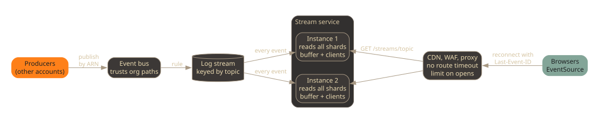

At work several teams push live updates to browsers: an order changes
state, a label is ready, a list should refresh. Each team built its own
WebSocket API for that. Meanwhile the rest of their traffic moved behind a
shared Envoy gateway (the one from
[an earlier post](/posts/self-service-routes-shared-envoy-gateway/)), and
the WebSocket APIs could not follow. The managed WebSocket APIs we used only
come with a public, regional endpoint
([AWS whitepaper](https://docs.aws.amazon.com/whitepapers/latest/best-practices-api-gateway-private-apis-integration/websocket-api.html)),
and our gateway only forwards to private ones.

So we built a proof of concept for one shared stream service behind the
gateway. In short:

> Publish every event to a log. Let every instance of the stream service
> read the whole log, and keep a short buffer of recent events in memory.
> Clients hold a Server-Sent Events connection to whichever instance the
> load balancer picks. A client that reconnects, to any instance, sends the
> id of the last event it saw and gets everything after it from that
> instance's buffer. No sticky sessions, no shared session store.

## The constraints

- **Through the gateway, like everything else.** The CDN, the WAF, the
  proxy and its rate limiter should treat a stream like any other request,
  so we keep one front door and one set of controls.
- **One direction is enough.** The browser listens. When it has something
  to say, it already has the owning team's API for that.
- **Producers live in other accounts.** Teams publish from their own
  accounts, so publishing is a cross-account call with a trust boundary.
- **No new stateful system.** A proof of concept should not need a cluster
  someone has to run.
- **Deploys happen.** Instances come and go, and every open connection on
  an instance dies with it.

## The pattern

### Why Server-Sent Events

A Server-Sent Events (SSE) stream is a plain `GET` whose response never
ends. The server writes small text blocks, and the browser's built-in
`EventSource` parses them:

```text
id: 1042
event: label-ready
data: {"shipment":"S-1","url":"/labels/S-1.pdf"}

```

To every hop on the way, that is an ordinary HTTP request. It passes the
CDN, the WAF and the proxy unchanged, and the rate limiter can count it
when it opens. A WebSocket upgrade, by contrast, turns into an opaque pipe:
after the handshake the proxy only sees bytes in both directions, so it
cannot limit or inspect messages.

`EventSource` also reconnects by itself and sends the last `id` it received
in a `Last-Event-ID` header. The design below uses that header for all of
its recovery.

### Every instance reads everything



Producers publish `{ topic, data }` to an event bus. A rule copies every
event into a log stream, keyed by topic so events on one topic stay in
order. Each instance of the stream service reads every shard of that log
from the moment it starts. When an event arrives, the instance looks up the
clients it holds for that topic and writes the event to each of them.

Because every instance sees every event, it does not matter which instance
a client lands on. The load balancer can spread connections however it
likes, and a reconnect after a deploy can go anywhere.

### A small buffer replaces a session store

Each instance keeps a fixed number of recent events in memory, across all
topics. When a client opens a stream with a `Last-Event-ID`, the instance
finds that id in its buffer, replays what came after it on the client's
topic, and then continues live. Since every instance read the same log, it
holds the same buffer, so a reconnect to a different instance still finds
the id. The exception is an instance that started a minute ago: its history
is shorter.

The core is small. A sketch:

```ts
type Event = { id: string; topic: string; data: string };
type Send = (text: string) => void;

class Fanout {
  private byTopic = new Map<string, Set<Send>>();
  private history: Event[] = [];

  constructor(private keep: number) {}

  join(topic: string, send: Send, lastId?: string): () => void {
    const from = lastId ? this.history.findIndex((e) => e.id === lastId) : -1;
    if (from >= 0) {
      this.history.slice(from + 1)
        .filter((e) => e.topic === topic)
        .forEach((e) => send(frame(e)));
    }
    const sends = this.byTopic.get(topic) ?? new Set<Send>();
    sends.add(send);
    this.byTopic.set(topic, sends);
    return () => sends.delete(send);
  }

  deliver(event: Event): void {
    this.history.push(event);
    if (this.history.length > this.keep) this.history.shift();
    this.byTopic.get(event.topic)?.forEach((send) => send(frame(event)));
  }
}

const frame = (e: Event) =>
  `id: ${e.id}\nevent: ${e.topic}\n` +
  e.data.split("\n").map((line) => `data: ${line}`).join("\n") + "\n\n";
```

The log's own sequence number makes a good event id: every instance sees
the same number for the same event, and it only grows.

### Keeping a quiet stream open

A stream can go minutes without an event, and every hop on the way has an
idle timeout: the CDN, each load balancer, the proxy. Two things keep the
connection alive:

- **The route has no request timeout.** A proxy route for normal APIs ends
  a request after some seconds. The stream route must not.
- **The server sends a heartbeat.** An SSE comment line (`:`) every few
  seconds, shorter than the shortest idle timeout on the path. Browsers
  ignore comments, and every hop sees traffic.

### Limit the opens, not the events

The gateway's rate limiter sees one request per stream, when it opens. So
we limit how often streams may be opened. Events on an open stream cost the
gateway nothing.

### Publishing from other accounts

The bus has a resource policy that lets roles from a list of organization
paths publish. Two details bit us while testing:

- An empty list of trusted paths must fail the deployment. A condition with
  no values is no condition at all, and the bus would be open to anyone.
- A producer must address the bus by its full ARN. A bare bus name refers
  to a bus in the caller's own account. When that bus does not exist, the
  publish call still reports zero failed entries, and the event goes
  nowhere.

## What we rejected

**One WebSocket API per team.** This was the starting point. It cannot sit
behind a private gateway, the proxy cannot limit messages, and we never
needed the second direction.

**Sticky sessions.** Pin each client to one instance and keep its missed
events there. It works until a deploy or a scale-in removes that instance,
which is exactly when clients reconnect. Recovery then depends on the one
instance that is gone.

**A shared pub/sub store.** Instances subscribe to a channel per topic in a
shared store, which also keeps the replay history. It scales further than
our design, and we would reach for it as a relay tier. For a proof of
concept it meant one more stateful system to run.

**A queue per instance.** Each instance gets its own queue, subscribed to
the bus. It avoids the shared read limit below, but needs bookkeeping for
instances that come and go, and a queue has no replay for a client that
moves to another instance.

## Tradeoffs

- **All instances share the log's read capacity.** With standard reads,
  every consumer of a shard shares five read calls per second and 2 MB per
  second
  ([Kinesis quotas](https://docs.aws.amazon.com/streams/latest/dev/service-sizes-and-limits.html)).
  Polling once a second, that is enough for a handful of instances. Beyond
  that you need dedicated throughput per consumer (Kinesis calls it
  enhanced fan-out, with a cap on registered consumers per stream) or a
  relay tier.
- **Polling adds latency.** An event waits up to one poll interval before an
  instance reads it. Push-based reads remove most of that.
- **Replay can fail without telling anyone.** The buffer is shared by all
  topics, so a busy topic pushes a quiet topic's events out sooner. A client
  whose last id has left the buffer gets live events only, and nothing tells
  it that it missed some. Clients that must not miss anything need a way to
  reload state, for example a normal `GET` after a reconnect.
- **New streams start at now.** Without `Last-Event-ID` there is no history.
  A client loads current state first and then opens the stream.
- **Deploys drop every stream.** Clients reconnect and replay, so they lose
  nothing as long as fewer events arrive during the reconnect than the
  buffer holds.
- **A route-wide limit is one shared budget.** If the limit on opens counts
  per route, one client that reconnects in a loop locks every other client
  out of new streams. We found this with our own burst test. For a service
  many clients share, limit per client instead, or as well.
- **Every instance does work for every event.** An instance reads and
  parses events nobody on it listens to. That is cheap at modest volume and
  wasteful at high volume.

## When not to use it

- **You need guaranteed delivery to each client.** This design delivers at
  least once while the client's last id is still in the buffer, and on a
  best-effort basis after that.
- **Clients need to send messages over the same connection.** Then you need
  WebSockets, and a gateway that understands them.
- **The event volume is high, or most instances serve few topics.** Reading
  everything everywhere stops paying off; route events to instances that
  need them through a relay.
- **You have one instance.** Then you do not need the log for fan-out at
  all, just the buffer.
